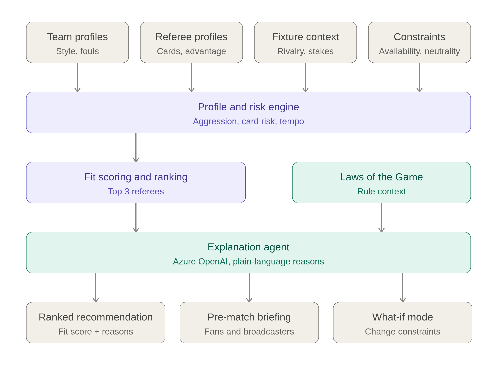

# RefMatch

**Explainable referee assignment before kickoff.**

RefMatch is a pre-match analytics agent concept for the *Inside the Game: Developer Hackathon (Microsoft × Premier League)*. It combines team playing styles, referee profiles, fixture context, and assignment constraints to recommend suitable referees and explain the reasoning behind each recommendation.

The project supports referee assignment decisions and produces accessible officiating briefings for fans and broadcasters. The prototype uses **synthetic data**, with all outputs labelled accordingly.

The core question: **Which available referee is the best fit for this fixture, and why?**

## Project status

RefMatch is in the planning stage. This repository contains the [skill specification](RefMatchSKILL.md) and [architecture diagram](docs/refmatch_architecture.png). The capabilities below describe the intended system; application code, runnable setup, and scoring formulas have not yet been implemented.

## Planned capabilities

- Build a match risk profile covering aggression, card risk, controversy risk, and tempo.
- Filter referees using availability, rest, and neutrality constraints.
- Rank the top three eligible referees with fit scores, supporting reasons, and risk flags.
- Explain recommendations in plain language with relevant Laws of the Game context.
- Generate a pre-match officiating briefing for fans and broadcasters.
- Recalculate rankings when constraints change, such as a referee becoming unavailable.

## Architecture

[Open the full architecture diagram](docs/refmatch_architecture.png).

Four input groups feed the **profile and risk engine**: team profiles, referee profiles, fixture context, and constraints. The **fit scoring and ranking** stage identifies the top three eligible referees. The **explanation agent** combines those rankings with a separate source of **Laws of the Game** context to produce ranked recommendations, pre-match briefings, and what-if explanations.

The scoring service calculates deterministic numeric results. Azure OpenAI provides plain-language explanations of those results. A what-if change returns to constraint filtering, scoring, and ranking before the explanation is updated.

## Assignment workflow

1. **Load inputs:** collect both teams' profiles, fixture context, referee profiles, and constraints. State assumptions for missing fields; request missing information if the inputs are too sparse for a meaningful ranking.
2. **Build the Match Risk Profile:** calculate aggression, card risk, controversy risk, and tempo.
3. **Apply hard constraints:** filter candidates by availability, rest requirements, and neutrality.
4. **Score referee fit:** compare each eligible referee's strengths with the match risk profile using the configured weights.
5. **Rank candidates:** return up to three eligible referees with percentage fit scores.
6. **Explain the ranking:** identify each candidate's top two positive drivers, one risk flag, neutrality status, and relevant Laws of the Game context.
7. **Explore further:** generate a pre-match briefing or rerun the ranking with changed constraints.

## Inputs

| Input group | Fields |
| --- | --- |
| Team profile, for each team | `pressing_intensity`, `foul_rate`, `physicality`, `card_tendency`, `dissent_history`, `possession_style` |
| Fixture context | `rivalry_level`, `stakes`, `is_derby`, `expected_tempo` |
| Referee profile | `cards_per_match`, `foul_tolerance`, `advantage_rate`, `penalty_rate`, `consistency`, `high_intensity_matches`, `history_with_teams` |
| Constraints | `available`, `rest_days`, `nationality`, `recent_games_with_team` |

Team numeric attributes use a 0–100 scale except `foul_rate`, which is measured per match. `possession_style` is `possession`, `direct`, or `counter`. Fixture `rivalry_level` and `expected_tempo` use a 0–100 scale; `stakes` is `none`, `title`, `european`, or `relegation`, and `is_derby` is a boolean.

Referee `consistency` uses a 0–100 scale, `high_intensity_matches` is a count, and `history_with_teams` lists recent matches. For constraints, `available` is a boolean and `recent_games_with_team` measures **months since the last match with either club**.

The [skill specification](RefMatchSKILL.md) provides the input schema. Exact normalization formulas, rest thresholds, and neutrality rules remain to be defined during implementation.

## Match Risk Profile

The risk engine produces four scores on a 0–100 scale from the two team profiles and fixture context.

| Dimension | Main drivers |
| --- | --- |
| Aggression | Combined physicality, pressing intensity, and foul rates |
| Card risk | Combined card tendencies, dissent history, and rivalry level |
| Controversy risk | Match stakes, derby status, and rivalry level |
| Tempo | Expected tempo and differences in possession styles |

## Referee fit scoring

Fit measures how well a referee's profile matches the fixture's risk profile. The specification defines these adjustable default weights:

| Component | Weight | Intended scoring behaviour |
| --- | --- | --- |
| Intensity experience | 25% | Higher aggression favours experience in high-intensity matches |
| Consistency | 20% | Higher controversy risk favours greater consistency |
| Advantage handling | 20% | Higher tempo favours a higher advantage rate |
| Card calibration | 15% | Higher card risk favours stable card rates without extremes |
| Familiarity | 10% | Heavy recent history with either club reduces fit |
| Rest and availability | 10% | Short rest reduces fit among eligible candidates |

The weights total 100%. Hard constraints determine eligibility before scoring; a high fit score cannot override an unavailable or otherwise ineligible candidate. The language model must explain the calculated scores without inventing or changing them.

## Outputs

### Ranked recommendation

Present the best fit given the data and up to two alternatives. For each candidate, include:

- A percentage fit score.
- The top two positive drivers, supported by the input numbers.
- One risk flag and an explicit neutrality status.
- A short explanation with relevant Laws of the Game context, such as fouls, misconduct, referee responsibilities, or advantage.

### Pre-match briefing

Provide three short paragraphs for fans and broadcasters:

1. The expected match tempo and physicality.
2. How the recommended referee is likely to manage that match profile.
3. Two or three moments to watch, such as advantage calls, early cards, or set pieces.

### What-if mode

When availability, neutrality, or another constraint changes, repeat filtering, scoring, ranking, and explanation. Report the new ranking, what changed and why, and fit score changes for the top three candidates.

## Example requests

- “Who should referee Team A vs Team B?”
- “Rank the available referees for this derby.”
- “Explain why Referee A was recommended.”
- “What changes if Referee A is unavailable?”
- “Write a pre-match officiating briefing.”

## Proposed stack

| Component | Technology | Purpose |
| --- | --- | --- |
| Scoring service | Python on Azure Functions | Calculate match risk and referee fit |
| Explanation agent | Azure OpenAI | Explain rankings and write briefings |
| Rule retrieval | Azure AI Search | Retrieve relevant Laws of the Game context |
| User interface | Web frontend; framework to be selected | Explore recommendations and change constraints |

## Explanation and data principles

- **Synthetic prototype:** label all prototype data and outputs as synthetic. Recommendations are not real referee evaluations or official Premier League decisions.
- **Controlled inputs:** use fictional referees and match histories by default. Real names or histories require explicit user-supplied data.
- **Traceable reasoning:** cite the input numbers that drive a recommendation and explain relevant Laws of the Game context in plain language without lengthy quotations.
- **Qualified recommendations:** describe the best fit given the data, state neutrality explicitly, and avoid claims of certainty or referee incompetence.
- **Clear interpretation:** fit scores describe suitability for a fixture; they do not predict match outcomes.
- **Transparent assumptions:** identify missing inputs and assumptions, and request more information when a meaningful ranking is not possible.

## Project documents

- [RefMatch skill and specification](RefMatchSKILL.md): input schemas, scoring weights, explanation rules, output formats, and what-if behaviour.
- [Architecture diagram](docs/refmatch_architecture.png): the proposed flow from inputs to recommendations and briefings.
