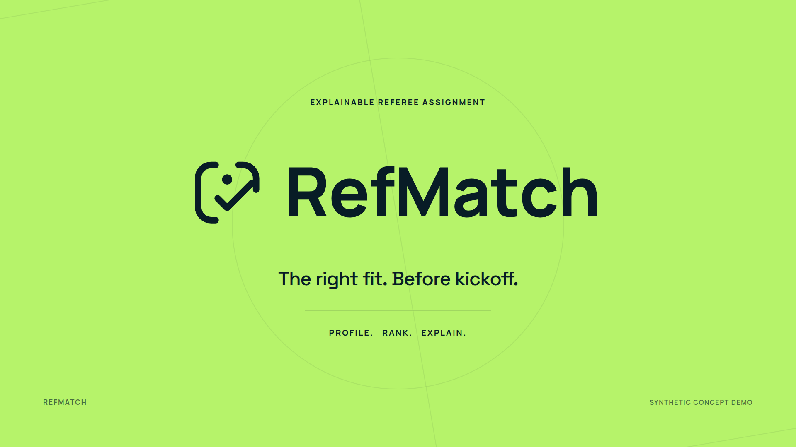

# RefMatch — 15-second concept film

[Watch or download the finished film](refmatch-15s.mp4).



## Delivery

- **Format:** 1920 × 1080, 16:9, 60 fps, exactly 15 seconds.
- **Video:** H.264 MP4, YUV 4:2:0, with fast-start metadata for browser playback.
- **Audio:** original stereo soundtrack, AAC at 48 kHz. The uncompressed [WAV master](refmatch-soundtrack.wav) is included.
- **Identity:** the repository's actual logo assets, locally bundled fonts, and JSON theme palette.
- **Accessibility:** readable on-screen text, optional [English captions](refmatch-captions.vtt), and user-initiated playback.
- **Data:** illustrative synthetic profiles and fit scores. The film demonstrates the intended product concept.

## Storyboard

| Time | On-screen message | Visual action |
| --- | --- | --- |
| 0.00–4.00 s | Read the match. | A tactical pitch and moving player markers resolve into a match risk profile. Team, referee, fixture, and constraint inputs sit below. |
| 4.00–8.00 s | Find the right fit. | Three referee cards appear, scores settle, and the strongest candidate receives the mint highlight. Availability, neutrality, and rest checks are visible. |
| 8.00–12.00 s | Know the why. | The leading referee's experience, consistency, neutrality, rest flag, and law context explain the recommendation. |
| 12.00–15.00 s | The right fit. Before kickoff. | A mint iris reveals the full RefMatch identity and the sequence “Profile. Rank. Explain.” |

Transitions overlap slightly around the scene boundaries. The synthetic-demo label remains visible throughout.

## Preview

Run `npm run preview` from the repository root:

- **http://127.0.0.1:4173/** — product landing page, founder profile, and finished film.
- **http://127.0.0.1:4173/brand/** — identity showcase and finished MP4 player.
- **http://127.0.0.1:4173/video/** — editable Canvas animation with playback, sound, and a timeline scrubber.

The animation is deterministic. `window.renderAt(seconds)` draws any frame between 0 and 15 seconds without depending on wall-clock time. The preview includes no external APIs or model calls.

## Re-render

Requires Node.js 22+, Python 3, FFmpeg with `libx264`, and Chromium or Google Chrome. FontTools is needed only when rebuilding SVG logos; the renderer itself uses Python's standard library for sound synthesis.

```sh
npm ci --no-audit
# Only needed if Chrome/Chromium is not already installed:
npx playwright install chromium

npm run render
```

The renderer uses `CHROME_PATH` if supplied, otherwise a detected system browser or Playwright's bundled Chromium. It serves files temporarily on localhost, exports 900 PNG frames directly from the Canvas to FFmpeg, and composes the soundtrack. The completed MP4 is published to its final filename only after its duration, frame count, and resolution pass validation. An interrupted render leaves the prior completed export intact. Temporary frame data is piped directly to the encoder.

Scene timing, duration, and frame rate live in `brand/tokens.json` and are shared by the animation, soundtrack, and renderer. The 15-second edition gives each main step approximately four seconds and the closing identity three seconds. The original 10-second MP4 remains available as an earlier export.

```sh
# Export the four scene stills, video poster, and transparent PNG logos:
npm run render:stills

# Use a particular browser executable:
CHROME_PATH=/path/to/chrome npm run render
```

## Editable sources

| File | Purpose |
| --- | --- |
| [film.js](film.js) | Animation, layouts, scene timing, and synthetic demo values |
| [index.html](index.html) | Playback and timeline controls |
| [theme tokens](../brand/tokens.json) | Shared colours, fonts, and output dimensions |
| [render.mjs](../scripts/render.mjs) | Browser rendering and MP4 encoding |
| [soundtrack.py](../scripts/soundtrack.py) | Original music and transition sounds |
| [build-brand.py](../scripts/build-brand.py) | Portable SVG logo generation with outlined lettering |

The SVG source logos are original vector artwork. The soundtrack is generated from oscillators and deterministic noise; it contains no licensed samples or external voice recordings.
